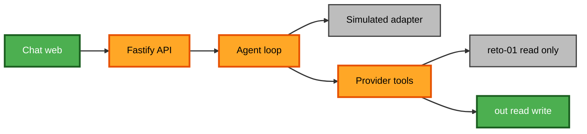

# Solución — Agente de Registro como Proveedor

## 1. Problema

La analista administrativa necesita preparar registros de proveedor sin transcribir datos ni buscar soportes repetidamente, mientras conserva control humano sobre firma y envío.

## 2. Arquitectura

Text alternative: el chat web llama la API Fastify; el ciclo coordina adaptador y herramientas. Las herramientas leen fixtures inmutables y escriben artefactos en `out/`.

- **Frontend**: `web/` contiene la interfaz de chat y visualización de tool calls.
- **Backend**: `src/server.ts` expone API JSON y sirve archivos estáticos.
- **Orquestación**: `src/agent/` mantiene sesiones en memoria, confirmación y ciclo del turno.
- **Ejecución**: `src/tools/proveedor.ts` expone las cinco herramientas obligatorias; `src/domain/` implementa reglas deterministas.
- **Conocimiento y prompt**: el comportamiento hoy está codificado en el adaptador simulado y reglas de dominio. `agent/prompt.md` y `src/knowledge/registro-proveedor.md` no se implementaron; se requieren antes de conectar un LLM real.

## 3. Ciclo del agente

El agente recibe `{ sessionId, message }`, recupera la sesión y usa un adaptador simulado para reconocer una instrucción de procesamiento. Para un caso válido ejecuta lectura, mapeo, generación y paquete; devuelve el resumen y las llamadas de herramienta.

El tope definido es de 25 llamadas por turno. La sesión conserva como máximo 100 mensajes en memoria. Cuando queda un envío pendiente, únicamente el mensaje siguiente con una de las frases exactas `enviar`, `sí, enviar` o `confirmo envío` crea `ENVIO-SIMULADO.md`. Cualquier otro mensaje descarta la acción pendiente.

## 4. Elección del modelo

La implementación actual usa un adaptador simulado determinista, sin proveedor ni modelo externo. Esto permite ejecutar `demo.ts`, pruebas y UI sin clave ni costo. El costo actual por caso es cero.

Para producción se recomienda implementar un adaptador de proveedor compatible con tool calling, configurado solo en el backend mediante variables de entorno, con timeout, límite de tokens y costo por sesión. La interfaz del adaptador separa el proveedor del ciclo.

## 5. Diseño del portal web

El formato portal no automatiza navegación. Genera `valores-portal.md` con datos listos para copiar. En producción se podría usar navegador controlado, RPA o extensión; CAPTCHA, MFA y cambios de layout limitan la automatización.

Las credenciales deben vivir en un gestor de secretos y ser ingresadas por una persona, nunca en el repositorio, prompt, frontend ni logs. La persona inicia sesión, resuelve CAPTCHA/MFA y hace clic en enviar; el agente solo prepara valores y evidencia.

## 6. Decisiones y trade-offs

1. **Fastify + Node.js 20+** en lugar de Bun o Express: Fastify aporta rutas y validación estructurada; implica más dependencias que Bun, pero un borde HTTP más consistente que Express sin middleware adicional.
2. **Adaptador simulado** en lugar de LLM real: entrega flujo reproducible sin clave ni costo; se descarta conversación libre real hasta incorporar prompt, conocimiento y proveedor.
3. **Sesiones en memoria** en lugar de base de datos: reduce complejidad para la demo; se pierden al reiniciar el proceso.
4. **ExcelJS y PDFKit** en lugar de plantillas binarias: los fixtures suministran definiciones JSON, no archivos binarios; se crean documentos nuevos y no se preserva formato de una plantilla real.
5. **Confirmación exacta** en lugar de lenguaje flexible: reduce envíos simulados accidentales; es menos cómoda para una usuaria.

## 7. Supuestos

- `reto-01/` contiene fixtures confiables e inmutables.
- Los soportes colombianos vigentes satisfacen solicitudes extranjeras, según la decisión aprobada.
- La fecha del sistema es la referencia de vigencia.
- Un campo obligatorio faltante bloquea firma, aunque el formulario se genere parcialmente.
- La defensa se ejecutará localmente; no hay enlace público implementado.

## 8. Cobertura

| Historia | Estado | Cobertura actual | Pendiente para producción |
|---|---|---|---|
| HU-1 Leer solicitud | Hecho | Lectura de solicitud, plantilla y soportes para los cuatro casos. | Adjuntos reales, OCR y correo. |
| HU-2 Mapear campos | Hecho | Glosario, rutas al maestro, faltantes y confirmación de RUC/RTN. | Mejor algoritmo de similitud y gobierno del maestro. |
| HU-3 Generar formulario | Parcial | XLSX, PDF y valores de portal generados desde JSON. | Rellenar plantillas binarias reales y validación visual de PDF/XLSX. |
| HU-4 Armar paquete | Parcial | Checklist, soportes, correo sin banco y envío simulado. | Firma, correo real y criterio jurídico por país. |
| HU-5 Errores | Parcial | Contrato JSON de herramientas, logs y pruebas locales. | Observabilidad, alertas, proveedor LLM real y recuperación persistente. |

## 9. Uso de IA

Se usó PERXIA para analizar el PRD y fixtures, estructurar AI-DLC, generar el esqueleto de TypeScript, documentación, pruebas y validaciones locales. Se descartó incorporar un proveedor LLM real en esta entrega porque no se definieron credenciales, proveedor ni modelo; se priorizó un adaptador simulado verificable. El código y decisiones deben revisarse antes de una entrega productiva.

## 10. Riesgos y mitigaciones

| Riesgo | Mitigación actual | Mitigación para producción |
|---|---|---|
| Datos inventados por LLM | Herramientas deterministas son la fuente de valores. | Prompt, validación de respuestas y políticas de tool calling. |
| Exposición de datos bancarios | Correo y logs los excluyen. | Clasificación de datos, mascaramiento y controles de acceso. |
| Traversal de rutas | Validación de identificador y raíces controladas. | Sandbox de filesystem y revisión de seguridad. |
| Soportes desactualizados | Comparación con fecha del sistema y bloqueo de firma. | Dueño del dato y alertas de vencimiento. |
| Sesiones perdidas | Aceptado para demo local. | Persistencia cifrada con expiración. |
| Portal con MFA/CAPTCHA | No se automatiza. | Human-in-the-loop y automatización asistida limitada. |
| Sin URL pública | Defensa local. | Despliegue PaaS con almacenamiento persistente, secretos y HTTPS. |
